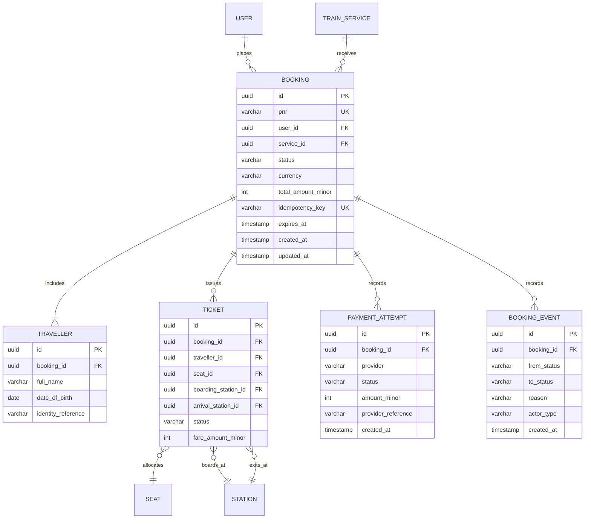

# Day 57 — Booking ERD

RailwayOS uses a booking aggregate to keep the passenger, selected service,
travellers, allocated seats, fare snapshot, simulated payment attempts, and
audit history connected without duplicating timetable data.

Existing `USER`, `TRAIN_SERVICE`, `SEAT`, and `STATION` records remain the
source of identity, timetable, inventory, and network truth. Booking records
store immutable fare and route snapshots so later timetable changes do not
rewrite a purchased ticket.
