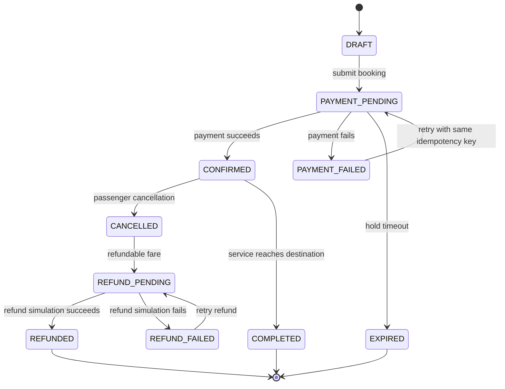

# Day 57 — Booking lifecycle

## Transition rules

| From | Allowed next states | Rule |
| --- | --- | --- |
| `DRAFT` | `PAYMENT_PENDING` | Validate travellers, route, fare, and inventory hold. |
| `PAYMENT_PENDING` | `CONFIRMED`, `PAYMENT_FAILED`, `EXPIRED` | Only one active payment attempt may settle the booking. |
| `PAYMENT_FAILED` | `PAYMENT_PENDING` | Retry is safe only with the original idempotency key. |
| `CONFIRMED` | `CANCELLED`, `COMPLETED` | Confirmed tickets cannot return to payment states. |
| `CANCELLED` | `REFUND_PENDING` | Cancellation releases held inventory exactly once. |
| `REFUND_PENDING` | `REFUNDED`, `REFUND_FAILED` | Refund is simulated and auditable. |

Unknown transitions must be rejected with a validation error and must not
modify ticket or inventory rows.

## Implementation

The transition guard is implemented in `backend/app/services/booking.py` and
covered by `backend/tests/test_booking_lifecycle.py`. Persistence models and
migrations remain the next day's work.
